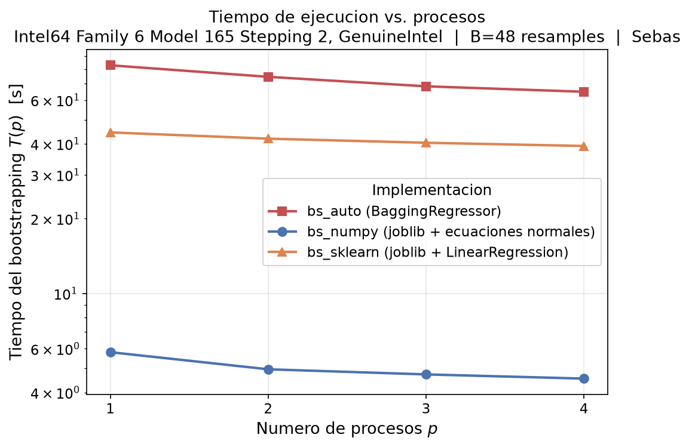
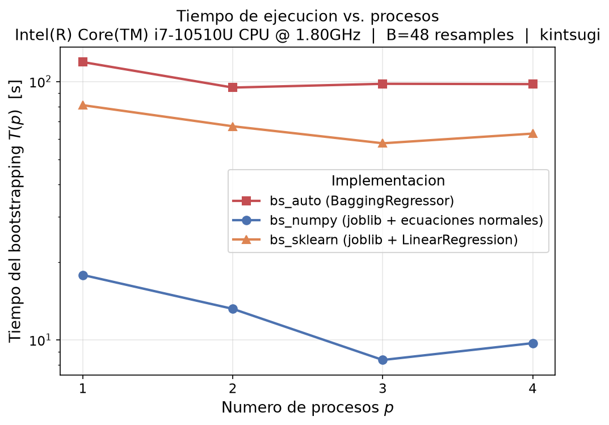
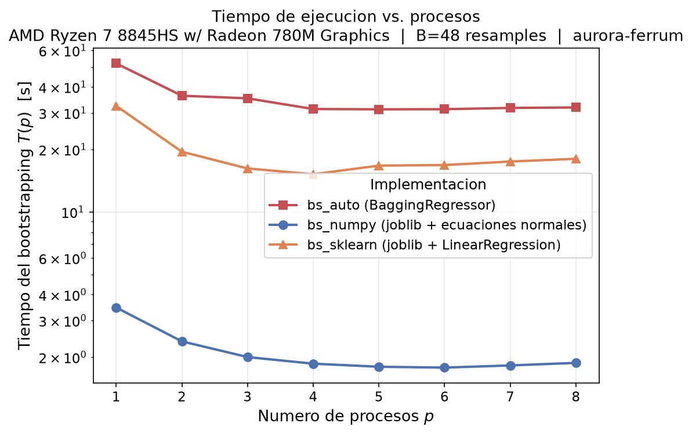
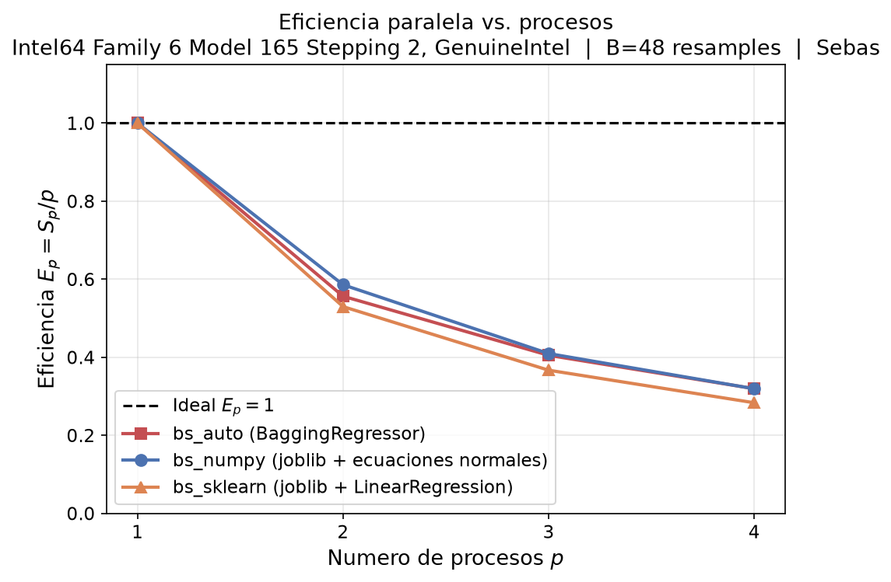
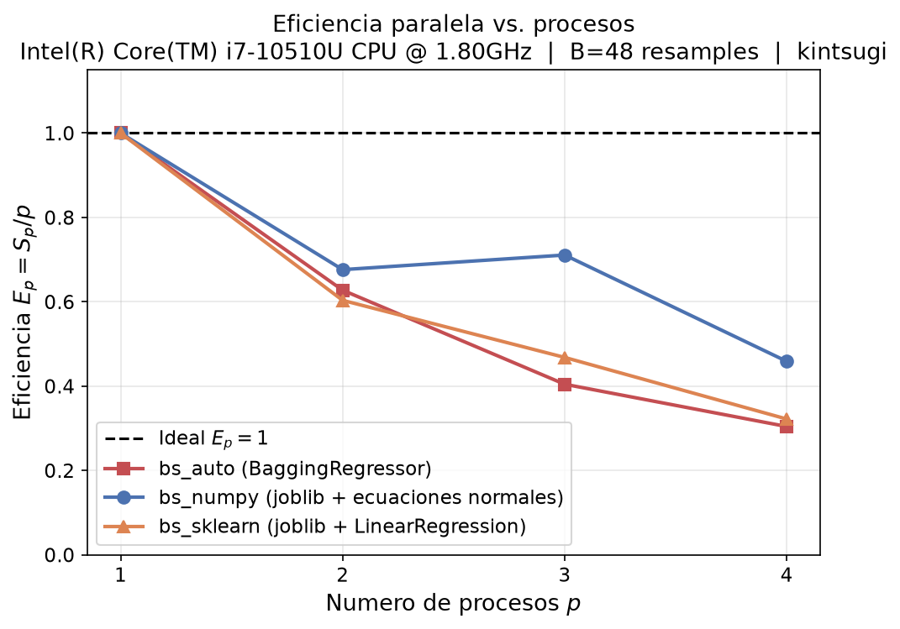
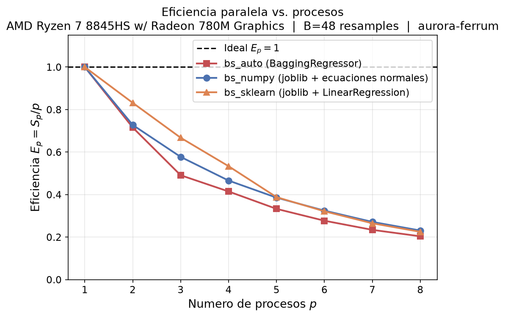

# Informe

## Integrantes
- Cristobal Albornoz
- Sebastián Barría
- Benjamín Peña

## Respuestas incisos:

### a) Generación de datos sintéticos

Véase:
```
gen_data.py
common.py
```

### b) Implementación de bootstrapping

Véase comentario al tope de cada archivo:
```
bs_auto.py
bs_sklearn.py
bs_numpy.py
common.py
```

### c) Correctitud y reproducibilidad

#### i)

Respecto a los IC, a nivel general, se usa una función *ci_percentil()* para poder calcularlos de igual manera al final de la ejecución de cada una de las variantes del algoritmo, entregando los *betas* calculados y el *alpha=0.05*, resultando en descartar 1 valor por lado (descarta el 2.5% superior o inferior, equivalente al multiplicar por B=48 --> 1) y lograr un nivel de confianza de 95% aproximadamente. Para verificar esto, se utiliza la función *cobertura()*, para poder calcular la fracción de los coeficientes verdaderos (BETA_STAR) que quedan dentro del IC, la cual se espera que rondee ese 95% en los resultados empíricos

En cuanto a los resultados obtenidos, al revisar el reporte obtenido en *tiempos_XXXX.csv* con XXXX = computador en el que fueron ejecutados los algoritmos, se puede apreciar que los IC tienden a tener características idénticas (ancho del IC promedio, cobertura de BETA_STAR y error relativo de BETA_STAR) para las variantes *sklearn* y *numpy*, y ligeramente distintas para las de la versión *auto* (tiene ligeramente peor cobertura, error relativo y es menos ancho que las otras 2)

Los resultados para cada una de las métricas se adjuntan a continuación:

| Métrica        | PC-1 (sebas)  | PC-2 (kintsugi) | PC-3 (aurora-ferrum) |
| -------------- | -------------: | -----------: | -----------: |
| Ancho          | 0.024227   (+) |     0.011812 |     0.011812 |
| Cobertura      |     88,5%  (-) |        ≈95%  |        ≈95%  |
| Error relativo | 0.00220527 (+) |   0.00042929 |   0.00042929 |

#### ii)

En cuanto a equivalencia, tanto *bs_numpy* como *bs_sklearn* usan ```common.child.seeds(B)``` (que usa SeedSequence) y ```common.bootstrap_weights(rng, N)```bajo la misma secuencia de semillas generados por ella, lo que significa que ambas versionas sortean los mismos N índices para el resample *b*, por ende armando los mismos X^(b) e y^(b) ponderado, siendo la única diferencia entre ambas el algoritmo usado para resolver el álgebra lineal del problema:
- bs_numpy: resuelve mediante ecuaciones normales con ```np.linalg.solve```, que hace uso de factorización LU en el producto de X con su transpuesta
- bs_sklearn: resuelve mediante ```LinearRegression```, que se basa en SVD (Descomposición de Valores Singulares)
Como ambos métodos resulelven el mismo sistema, las diferencias entre sus resultades probablemente se deban a errores de redondeo de puntos flotantes, lo cuál tiene ordenes de magnitud muy bajos (1*10^{10} o {12} aprox), lo que se traduce en resultados casi idénticos, como se puede ver en las métricas antes mencionadas, donde para ambos computadores dan = valores.

Por otro lado, *bs_auto* es comparable pero no tan idéntido, de ahí la ligera diferencia entre valores vistos previamente, pues utiliza ```BaggingRegressor```el cual hace su propio muestreo bootstrap interno con su propio generador de índices distntos al SeedSequence utilizado por los otros 2. Así, aunque se esté usando la misma semilla, al tener un mecanismo de generación de números aleatorios distinto al ```common.child.seeds(B)```, los índices que termina sorteando no coinciden resample a resample con los de *bs_numpy* y *bd_sklearn*
- Aquí cabe mencionar que la diferencia radica principalmente en ese muestreo distintos del conjunto de B coeficientes, pero el mecanismo de bootstrap se mantiene el los 3, por lo que siempre es comparable
- Otro aspecto a considerar, aunque del lado computacional, no de resultados, es que *bs_auto* no descarta la fila de peso 0 a diferencia de la implementación en ```common.weighted_design```, lo que si las descarta, lo que lo hace más lento como se puede ver en los resultados de los .csv

#### iii)

Para que los resultados sean reproducibles se necesita:
- **= semilla en la generación de datos**: Por ello en ```gen_data.py```se usa una semilla fija al momento de ejecutar ```np.random.default_rng(seed)``` al crear los datos sintéticos aleatorios, lo que logra que X y BETA_STAR sean ideńtidos entre ejecuciones y computadores.

**NOTA**: Además, se guardan los arreglos en un *.npy* para que las 3 variantes de bootstrapping puedan usar los mismos datos y puedan mediante *mmap mode="r"* poder abrirlos sin duplicar la memoria entre procesos. Esto es lo que queda en la carpeta **/data** en forma de `beta_star.npy, X.npy, y.npy`

- **semillas independientes por resample y desacopladas de p**: Como ```default_rng(seed + b)```no da garantías de independencias entre streams, pudiendo haber colisiones, si se usara podría hacer que el resultado de las operaciones dependa del orden de ejecución y por ende de *p*. Por ello se plantea usar `p.random.SeedSequence().spawn(B)` en ```common.child_seeds```, para generar B streams estadísticamente independientes (lo garantiza al alejarlos mucho mediante el uso de hashing criptográfico) y generar streams que provoquen que el mismo resample *b* (*b=i*) siempre reciba la misma semilla hija, sin importar cuantos procesos p se usen o cómo *joblib* reparta las tareas entre ellos
     - Esto es la base que permite comparar tiempos de ejecución para sitinto *p* sin que el valor del resultado cambie


- **= numero de hilos internos**: Como el producto de X con su transpuesta se calcula con BLAS y este puede llegar a usar múltiples hilos, la suma de los productos internos puede hacerse en distintos orden según esos distintos hilos, afectando el resultado, por ello para lograr una reproductibilidad más exacta conviene usar el mismo número de hilos internos

- **= versión de las librerías**: como la implementación depende mucho del funcionamiento de las librerías (Numpy, Sklearn, ...), variaciones de versiones en estas pueden generar algoritmos ligeramente distintos, lo que puede generar cierta variabilidad aunque sea menor en los resultados, por ello conviene usar = version para lograr una buena reproductibilidad 

- **= dtype**: La cossa cambia si uno usa puntos flotantes de tipo *float32* que *float64*, por ello para fomentar la reproducibilidad, conviene usar = tipo de dato

- **no reusar estado entre versiones/subprocesos**: así evitando que el pool del backend utilizado pueda contaminar la siguiente medición, por eso ```bench.py```hace que cada subproceso sea una nueva versión. Esto más que nada respecto a reproducibilidad temporal que resultados

### d) Backend de multiprocessing de joblib

#### i)

El backend de **multiprocessing** utiliza por defecto **loky** (además se setea **loky** a lo largo de la tarea) y gestiona la creación de los **p** procesos hijo. Para la creación de procesos normalmente se usa **fork** en Linux y **spawn** en macOS y Windows
- **fork:** aquí el SO clona el proceso padre, creando un proceso hijo que tiene una copia ideńtica del espacio de direcciones y la tabla de paǵinas de la memoria virtual del padre
- **spawn:** inicia un ejecutable de Python desde 0, completamente limpio: nuevo interprete, reimporta módulos y reconstruye el contexto de ejecución pasando los argumentos vía serialización

En cuanto a la asignación de memoria, **fork** intenta utilizar **Copy on Write (CoW)**, evitando asignar nueva memoria RAM física, por ende duplicando los datos del programa, sino que hace que el proceso hijo comparta las mismas páginas físicas de la RAM que su padre bajo solo permisos de lectura. Así, solo cuando el padre o el hijo intenten escribir en esa página, el sistema hage un **page fault**, duplicando esa página específica y le asigna memoria RAM física dedicada al hijo. Pero, existe el gran problema que el Garbage Collector y el contador de referencias modifican los encabezados (contadores de referencia) de los objetos en memoria constantemente, incluso para operaciones de lectura, lo que rompe la optimización del **COW**, forzando al SO a duplicar las páginas de RAM innecesariamente.
- Si se utilizara **spawn**, se asigna un bloque de RAM independiente desde el inicio, por lo que eso no pasa

#### ii)

En cuanto al manejo de **X** e **y** en *Joblib*, para arreglos grandes de NumPy (umbral de 1 MB aprox) *joblib* usa **Memory Mapping (memmap)**, almacenando termporalmente los arreglos en una RAM compartida (/dev/shm) antes de lanzar las tareas paralelas, entregando solo punteros de lectura mapeados en memoria a cada uno de los **p** procesos (no copias de los datos). Así los procesos leen directamente de los bloques de la matriz original de la RAM, generando un acceso concurrente sin duplicación.

Esto se hace para evitar caer en usar los pipes estandar de **multiprocessing**, en los cuales se tendría que aplicar  **pickling (serialización)** a los arreglos y transmitirlos mediante los canales (sockets/pipes) de IPC (comunicación entre procesos) a cada uno de los **p** procesos, lo cual generaría un consumo masivo de memoria al duplicar **p** veces los arreglos en la RAM, además de añadir la penalización temporal relacionada a la serialización

### e) Inspección de threads

#### i) 

Se corrió el siguiente código en PC-3 (ver specs en inciso f). Primero con el numero exacto de cores físicos:

```sh
python bs_numpy.py -p 8
============================
[bs_numpy] p=8 B=48 hilos_internos=1 dtype=float64
  tiempo bootstrap :    1.949 s
  hilos totales    : 8 (nucleos fisicos: 8) tasa uso : 1.0
  ancho IC medio   : 0.011812
  cobertura beta*  : 0.950
  ||mean(b)-bhat|| : 4.29e-04
```

Luego, con el numero exacto de cores lógicos:

```sh
python bs_numpy.py -p 16
============================
[bs_numpy] p=16 B=48 hilos_internos=1 dtype=float64
  tiempo bootstrap :    2.476 s
  hilos totales    : 16 (nucleos fisicos: 8) tasa uso : 2.0
  ancho IC medio   : 0.011812
  cobertura beta*  : 0.950
  ||mean(b)-bhat|| : 4.29e-04
```

Y finalmente con un número mayor al de cores lógicos:

```sh
python bs_numpy.py -p 32
============================
[bs_numpy] p=32 B=48 hilos_internos=1 dtype=float64
  tiempo bootstrap :    2.672 s
  hilos totales    : 32 (nucleos fisicos: 8) tasa uso : 4.0
  ancho IC medio   : 0.011812
  cobertura beta*  : 0.950
  ||mean(b)-bhat|| : 4.29e-04
```

Notamos que luego de sobrepasar el numero de cores físicos el tiempo de bootstrap toma más tiempo, lo que es un síntoma de la sobresubscripción.

#### ii)

Notamos que en el código el problema ocurre dado que no se limita el numero máximo de workers según los cores físicos. Por lo que se puede prevenir este problema al agregar un techo tal que:

$$p <= cores\_fisicos$$

### f) Cores lógicos de computador

| Métrica        | PC-1 (sebas)  | PC-2 (kintsugi) | PC-3 (aurora-ferrum) |
| -------------- | -------------: | -----------: | -----------: |
| Cores lógicos  | 8  | 8  | 16 |
| Cores físicos  | 4  | 4  | 8  |

#### Resultados PC-1

| p | bs_auto | bs_numpy | bs_sklearn |
|---:|---:|---:|---:|
| 1 | 73.493 | 6.431 | 42.273 |
| 2 | 71.334 | 4.848 | 41.773 |
| 3 | 62.907 | 4.994 | 37.568 |
| 4 | 61.056 | 4.568 | 38.712 |



#### Resultados PC-2

| p | bs_auto | bs_numpy | bs_sklearn |
|---:|---:|---:|---:|
| 1 | 118.865 | 17.831 | 80.963 |
| 2 | 94.721 | 13.185 | 67.087 |
| 3 | 97.95 | 8.361 | 57.659 |
| 4 | 97.677 | 9.716 | 62.858 |



#### Resultados PC-3

| p | bs_auto | bs_numpy | bs_sklearn |
|---:|---:|---:|---:|
| 1 | 52.009 | 3.467 | 32.474 |
| 2 | 36.338 | 2.382 | 19.52 |
| 3 | 35.3 | 2.001 | 16.216 |
| 4 | 31.354 | 1.86 | 15.214 |
| 5 | 31.247 | 1.798 | 16.734 |
| 6 | 31.287 | 1.781 | 16.841 |
| 7 | 31.742 | 1.824 | 17.509 |
| 8 | 31.904 | 1.876 | 18.05 |




### g) T(p), S(p), E(p)

#### PC-1



##### bs_auto

| p | T(p) [s] | S(p) | E(p) |
|---:|---:|---:|---:|
| 1 | 73.493 | 1.000 | 100.0% |
| 2 | 71.334 | 1.030 | 51.5% |
| 3 | 62.907 | 1.168 | 38.9% |
| 4 | 61.056 | 1.204 | 30.1% |

##### bs_numpy

| p | T(p) [s] | S(p) | E(p) |
|---:|---:|---:|---:|
| 1 | 6.431 | 1.000 | 100.0% |
| 2 | 4.848 | 1.327 | 66.3% |
| 3 | 4.994 | 1.288 | 42.9% |
| 4 | 4.568 | 1.408 | 35.2% |

##### bs_sklearn

| p | T(p) [s] | S(p) | E(p) |
|---:|---:|---:|---:|
| 1 | 42.273 | 1.000 | 100.0% |
| 2 | 41.773 | 1.012 | 50.6% |
| 3 | 37.568 | 1.125 | 37.5% |
| 4 | 38.712 | 1.092 | 27.3% |

#### PC-2



##### bs_auto

| p | T(p) [s] | S(p) | E(p) |
|---:|---:|---:|---:|
| 1 | 118.865 | 1.000 | 100.0% |
| 2 | 94.721 | 1.255 | 62.7% |
| 3 | 97.950 | 1.214 | 40.5% |
| 4 | 97.677 | 1.217 | 30.4% |

##### bs_numpy

| p | T(p) [s] | S(p) | E(p) |
|---:|---:|---:|---:|
| 1 | 17.831 | 1.000 | 100.0% |
| 2 | 13.185 | 1.352 | 67.6% |
| 3 | 8.361 | 2.133 | 71.1% |
| 4 | 9.716 | 1.835 | 45.9% |

##### bs_sklearn

| p | T(p) [s] | S(p) | E(p) |
|---:|---:|---:|---:|
| 1 | 80.963 | 1.000 | 100.0% |
| 2 | 67.087 | 1.207 | 60.3% |
| 3 | 57.659 | 1.404 | 46.8% |
| 4 | 62.858 | 1.288 | 32.2% |

#### PC-3



##### bs_auto

| p | T(p) [s] | S(p) | E(p) |
|---:|---:|---:|---:|
| 1 | 52.009 | 1.000 | 100.0% |
| 2 | 36.338 | 1.431 | 71.6% |
| 3 | 35.300 | 1.473 | 49.1% |
| 4 | 31.354 | 1.659 | 41.5% |
| 5 | 31.247 | 1.664 | 33.3% |
| 6 | 31.287 | 1.662 | 27.7% |
| 7 | 31.742 | 1.638 | 23.4% |
| 8 | 31.904 | 1.630 | 20.4% |

##### bs_numpy

| p | T(p) [s] | S(p) | E(p) |
|---:|---:|---:|---:|
| 1 | 3.467 | 1.000 | 100.0% |
| 2 | 2.382 | 1.455 | 72.8% |
| 3 | 2.001 | 1.733 | 57.8% |
| 4 | 1.860 | 1.864 | 46.6% |
| 5 | 1.798 | 1.928 | 38.6% |
| 6 | 1.781 | 1.947 | 32.4% |
| 7 | 1.824 | 1.901 | 27.2% |
| 8 | 1.876 | 1.848 | 23.1% |

##### bs_sklearn

| p | T(p) [s] | S(p) | E(p) |
|---:|---:|---:|---:|
| 1 | 32.474 | 1.000 | 100.0% |
| 2 | 19.520 | 1.664 | 83.2% |
| 3 | 16.216 | 2.003 | 66.8% |
| 4 | 15.214 | 2.134 | 53.4% |
| 5 | 16.734 | 1.941 | 38.8% |
| 6 | 16.841 | 1.928 | 32.1% |
| 7 | 17.509 | 1.855 | 26.5% |
| 8 | 18.050 | 1.799 | 22.5% |

#### Comentarios:

Se utilizó T(1) como el tiempo con un sólo worker para par cada implementación en cada computador de forma que sea más fácil comparar la pérdida de eficiencia.

### h) Overhead según p


### i) Versión más eficiente

Notamos que la versión más eficiente fue por lejos la implementación de numpy. Como se vió en los datos expuestos anteriormente, el desempeño fue el mejor en los 3 equipos probados. Obteniendo el menor tiempo, y mayor retención de eficiencia y speedup a medida que se agregan workers.

A continuación adjuntamos los datos conseguidos en PC-3:

...

### j) Comparación de resultados

